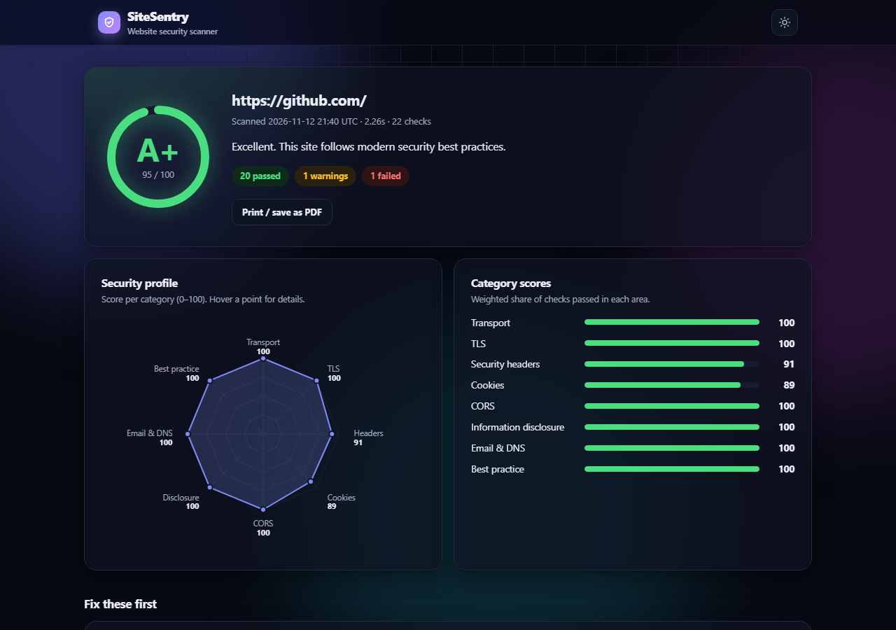
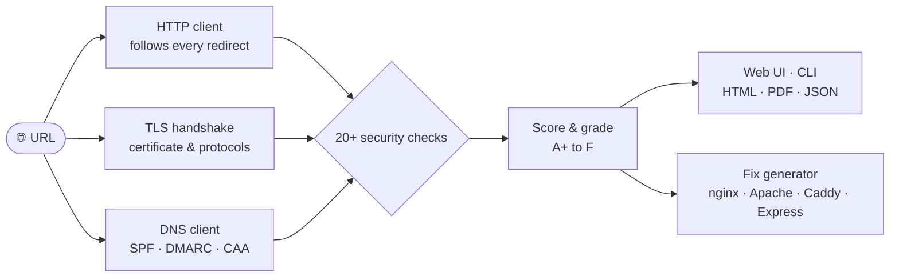
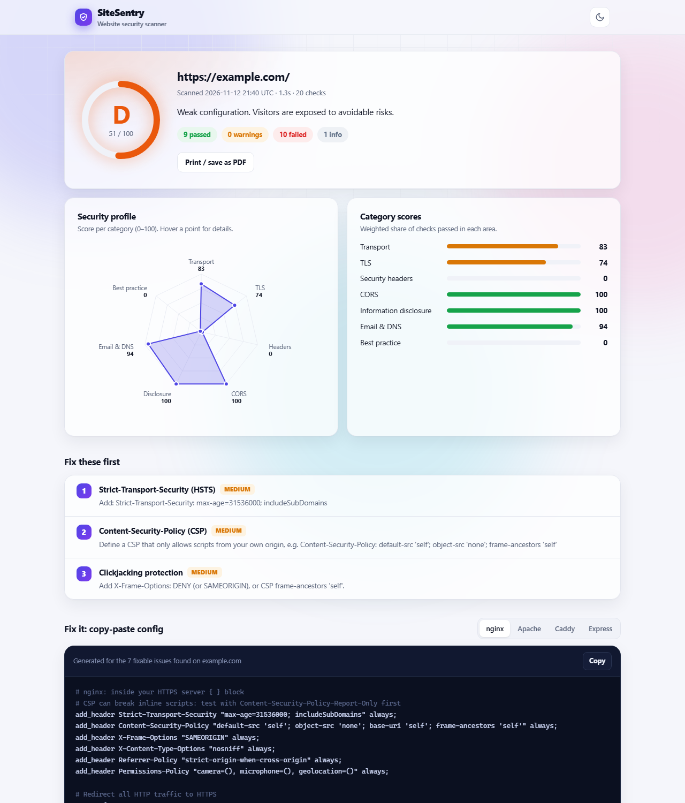
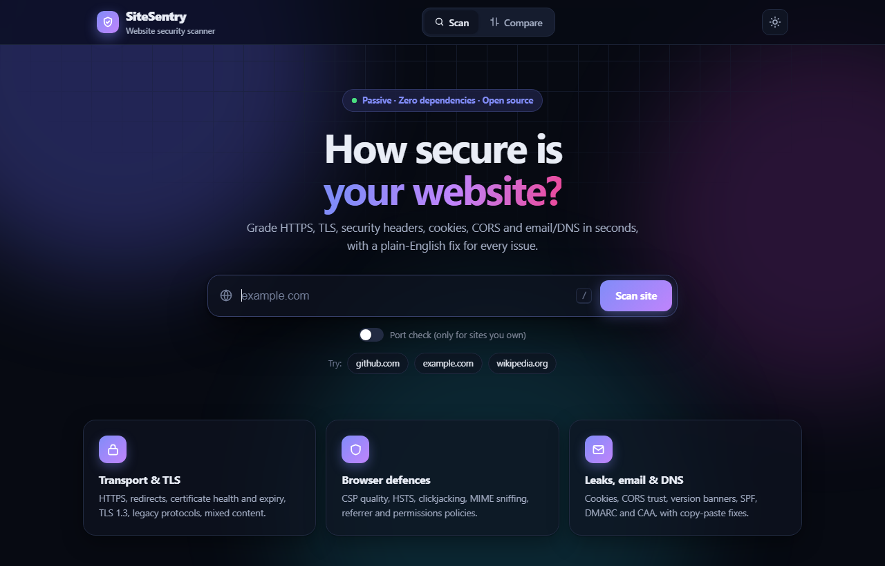
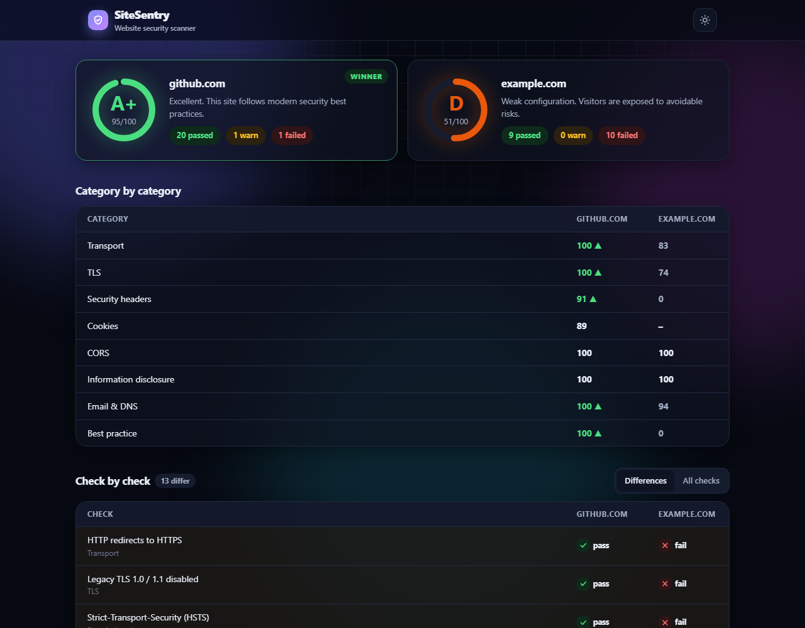

<div align="center">

# 🛡️ SiteSentry

**Know how secure your website is in five seconds.**

A passive website security scanner with a clean web interface. It grades HTTPS, TLS, security headers, cookies, CORS and email/DNS records from **A+ to F**, explains every issue in plain English, and **generates the config that fixes it**.


[](https://github.com/vicuvi1/SiteSentry/actions/workflows/ci.yml)


[](https://github.com/vicuvi1/SiteSentry/actions/workflows/codeql.yml)


**[🌐 Project page](https://vicuvi1.github.io/SiteSentry/)** · **[📊 Research: 100 popular sites scanned](https://vicuvi1.github.io/SiteSentry/research.html)** · **[📄 Live report: github.com (A+)](https://vicuvi1.github.io/SiteSentry/report-github.com.html)** · **[📄 Live report: example.com (D)](https://vicuvi1.github.io/SiteSentry/report-example.com.html)** · **[⚖️ Live comparison](https://vicuvi1.github.io/SiteSentry/compare-github-vs-example.html)**

<sub>Made by <a href="https://github.com/vicuvi1"><b>Victor Barbuta</b></a></sub>



</div>

---

## Introduction

**SiteSentry checks how well a website protects its visitors.** You give it an address, and a few seconds later it tells you what is set up correctly, what is missing and exactly what to change. It sums all of that up as a single grade from **A+ to F** that anyone can understand.

It looks at what a browser, and an attacker, can see from the outside:

- 🔒 **Is the connection really encrypted?** HTTPS, certificate health, modern TLS versions.
- 🛡️ **Does the site switch on the browser's built-in defences** against cross-site scripting, clickjacking and content sniffing?
- 🍪 **Can session cookies be stolen**, or can other websites read a logged-in user's data (CORS)?
- ✉️ **Could someone send emails pretending to be this domain?** SPF, DMARC and CAA records.
- 🕵️ **Is the server leaking** software versions that make known exploits easy to find?

SiteSentry **never tries to break in**. Every check is a normal request, the same as visiting the page in a browser, so the scan is safe and fast.

**Who it's for**

| | |
|---|---|
| 👩‍💻 **Developers** | Check secure defaults before going live and copy the exact server config that fixes each issue. |
| 🎓 **Students & junior analysts** | See how web security works in practice: every finding explains *why* it matters, with links to OWASP and MDN. |
| ⚙️ **DevOps / DevSecOps teams** | Add an automatic security gate to CI/CD with `--fail-under B`. |

### How it works



## 📊 Research: I scanned 100 popular websites

Using SiteSentry, I scanned 100 of the world's most widely used websites. **Only 31% earn an A or better, 52% have no Content-Security-Policy at all, and 13% still accept TLS 1.0/1.1**, while email defences (SPF 99%, DMARC enforced 91%) are far ahead of browser-side protections.

**[Read the full report with charts and per-site data →](https://vicuvi1.github.io/SiteSentry/research.html)** · reproducible with [`research/`](research/)

## Why I built this

Most website breaches don't need a zero-day. They come from missing basics: no HSTS, a reflected CORS origin, session cookies without `Secure`, no DMARC so anyone can send email as your domain. I wanted a tool that:

- **finds those misconfigurations fast, without being intrusive** (only normal, browser-like requests),
- **explains why each one matters and fixes it**, with copy-paste config for nginx, Apache, Caddy or Express,
- **fits into a DevSecOps pipeline**: `--fail-under B` breaks the build when security gets worse.

## Features

| Area | What it checks |
|---|---|
| **Transport** | HTTPS availability · HTTP→HTTPS redirect · mixed content (scripts/styles loaded over HTTP) |
| **TLS** | Certificate validity & expiry · negotiated protocol (TLS 1.2/1.3) · legacy TLS 1.0/1.1 still accepted |
| **Security headers** | HSTS (incl. max-age) · Content-Security-Policy *quality* (`unsafe-inline`, `unsafe-eval`, wildcards, nonces) · clickjacking (XFO / `frame-ancestors`) · `X-Content-Type-Options` · `Referrer-Policy` · `Permissions-Policy` |
| **Cookies** | `Secure`, `HttpOnly`, `SameSite`, and the invalid `SameSite=None` without `Secure` |
| **CORS** | Sends a forged `Origin` to detect **origin reflection with credentials** and trusted `null` origins |
| **Email & DNS** | **SPF** (missing, `+all`, `?all`, duplicates) · **DMARC** policy (`none` / `quarantine` / `reject`) · **CAA** (inherited from parent domains) |
| **Info disclosure** | Versioned `Server` banners · `X-Powered-By` and other framework fingerprints |
| **Best practice** | `/.well-known/security.txt` (RFC 9116) |
| **Exposed services** *(opt-in)* | 13 commonly abused ports: Redis, MongoDB, Elasticsearch, MySQL, RDP, Docker API… |

### Copy-paste fixes

Every scan generates ready-to-use configuration for the issues it found, for **nginx, Apache, Caddy and Express**, with one-click copy.



### The web interface

- **Live scan console:** watch every step stream in real time from the server (Server-Sent Events).
- **Security profile:** a radar chart and per-category scores show strong and weak areas at a glance.
- **Compare mode:** scan two sites side by side, e.g. staging vs production or you vs a competitor.
- Light and dark themes, recent scans, shareable `?url=` links, a `/` keyboard shortcut, and downloadable HTML / JSON / PDF reports.





## Quick start

Zero dependencies, only Python 3.11+.

```bash
git clone https://github.com/vicuvi1/SiteSentry.git
cd SiteSentry

# Web interface (opens your browser at http://127.0.0.1:8765)
python -m sitesentry --serve

# Command line
python -m sitesentry example.com
python -m sitesentry example.com --html report.html --json report.json
```

Optionally install it as a command with `pip install ".[certs]"` and then run `sitesentry example.com`. The optional `certs` extra adds Mozilla's CA bundle, so certificate results are identical on every OS.

### Docker

```bash
docker build -t sitesentry .
docker run --rm sitesentry example.com                 # CLI
docker run --rm -p 8765:8765 sitesentry --serve --host 0.0.0.0 --no-browser   # web UI
```

### Use it in CI/CD

```yaml
- name: Security gate
  run: python -m sitesentry https://staging.myapp.com --fail-under B
```

Catch regressions between deploys by comparing with the last report:

```bash
sitesentry https://myapp.com --json today.json --baseline yesterday.json --fail-on-regression
```

Exit codes: `0` = OK, `1` = grade below `--fail-under` or a regression, `2` = scan error.

### Bulk scans and comparisons

```bash
sitesentry --list sites.txt --csv results.csv      # one site per line, scanned in parallel
sitesentry --compare staging.myapp.com myapp.com --html compare.html
```

### Running it as a shared service

The web server fetches URLs on behalf of whoever can reach it, so it is hardened against **SSRF**:

- private, loopback, link-local and other reserved addresses are refused (including IPv4-mapped and 6to4 IPv6 tricks), so it can't be used to probe `192.168.x.x` or the cloud metadata service at `169.254.169.254`
- connections are **pinned to the vetted IP**, which defeats DNS rebinding, and **every redirect hop is re-checked**
- a Host-header allow-list on loopback servers blocks DNS-rebinding attacks against the UI itself
- per-client rate limiting, a cap on concurrent scans, and the port check disabled in shared mode

Use `--allow-private` only when you deliberately want to scan your own internal or dev servers.

<details>
<summary><b>All CLI options</b></summary>

```
sitesentry [target] [--serve] [--host HOST] [--port PORT] [--no-browser] [--allow-private]
           [--html FILE] [--json FILE|-] [--csv FILE] [--no-color]
           [--compare SITE_A SITE_B] [--list FILE] [--workers N]
           [--ports] [--no-dns] [--timeout SECONDS]
           [--fail-under GRADE] [--baseline FILE] [--fail-on-regression]
```
</details>

## How the grade works

Every check has a severity. A failed check removes points from 100 (critical 30 · high 15 · medium 8 · low 3), and a warning removes half that. Any **critical** failure (no HTTPS, invalid or expired certificate) forces an **F**, because no amount of good headers makes up for that.

| Score | 95+ | 85+ | 70+ | 55+ | 40+ | <40 |
|---|---|---|---|---|---|---|
| Grade | A+ | A | B | C | D | F |

## Architecture

```
sitesentry/
├── net.py          # stdlib HTTP client: manual redirects, keeps every hop & repeated headers
├── dns.py          # DNS client from scratch (RFC 1035): UDP + TCP fallback, compression pointers
├── safety.py       # SSRF guard: blocks internal targets, pins connections to vetted IPs
├── scanner.py      # orchestrates checks, handles HTTPS→HTTP fallback & bad certificates
├── checks/         # one module per area; pure functions → easy to unit-test
│   ├── headers.py  cookies.py  cors.py  tls.py  email_dns.py
│   └── transport.py  content.py  disclosure.py  misc.py
├── scoring.py      # findings → 0-100 score → grade, plus per-category scores
├── diff.py         # compare with a baseline report → regressions / improvements
├── bulk.py         # parallel scans of many sites, CSV output
├── report.py       # terminal / JSON / standalone HTML
├── web.py          # web server: JSON API + live progress stream (SSE)
└── ui/index.html   # single-page UI (also the HTML report template)
```

Design decisions:
- **Zero dependencies.** Built on `http.client`, `ssl` and `socket`. The standard library can't query TXT or CAA records, so I wrote a **small DNS client** that builds query packets by hand and parses binary responses, including compression pointers and TCP fallback for truncated answers.
- **Checks are pure functions** that take collected data and return `Finding` objects. 85 unit, end-to-end and attack-driven security tests run without internet access: against hand-built DNS packets, a fake resolver, and a local, deliberately insecure web server.
- **Security tooling on itself.** Every push runs **CodeQL** (security-extended queries), **ruff** with bandit security rules, and **mypy**. Dependabot keeps CI and Docker dependencies current.
- **It follows its own advice.** The web UI is served with a strict **nonce-based CSP**, `frame-ancestors 'none'`, `nosniff` and `no-referrer`. Scan data embedded in HTML reports is escaped so a malicious target can't inject script into your report, and a regression test checks this.

## Ethics & legal

SiteSentry is **passive**: it makes the same kind of requests a browser does (a few GETs, TLS handshakes and public DNS lookups). The optional port check (`--ports` / the checkbox in the UI) opens TCP connections, so **only use it on systems you own or are authorised to test**.

## Skills demonstrated

`Python` · `SSRF defence` · `security research` · `HTTP, TLS & DNS internals` · `binary protocol parsing` · `OWASP secure headers` · `CSP / CORS analysis` · `email security (SPF, DMARC)` · `secure coding` · `automated testing` · `CI/CD (GitHub Actions)` · `Docker` · `DevSecOps` · `UI design` · `technical writing`

## Roadmap

- [x] SPF, DMARC and CAA checks
- [x] Copy-paste fix generator (nginx, Apache, Caddy, Express)
- [x] Docker image
- [x] SSRF hardening for shared deployments
- [x] Research: 100 popular websites scanned
- [ ] DNSSEC validation
- [x] Compare two sites, and catch regressions against a baseline
- [x] Live scan progress, security profile radar, bulk scanning
- [ ] Detect exposed files (`/.git/`, `/.env`) with explicit authorisation

See [CHANGELOG.md](CHANGELOG.md) for release history.

## Author

<table>
  <tr>
    <td></td>
    <td>
      <b>Made by Victor Barbuta</b><br>
      Designed and built as a hands-on cybersecurity project.<br>
      <a href="https://github.com/vicuvi1">GitHub @vicuvi1</a>
    </td>
  </tr>
</table>

Found a bug or have an idea? [Open an issue](https://github.com/vicuvi1/SiteSentry/issues). Found a security vulnerability? Please follow the [security policy](SECURITY.md). If SiteSentry helped you, a ⭐ is appreciated.

## License

MIT © 2026 Victor Barbuta
